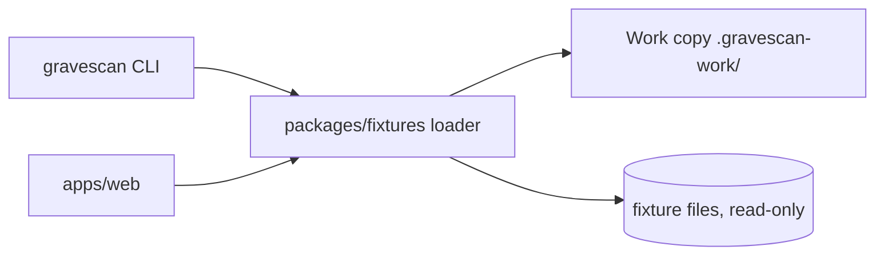

# Design: Project Foundation

## Overview
A pnpm TypeScript monorepo. This spec delivers the skeleton, quality gates, the fixture loader, and the isolated work copy. It contains no scanner, simulator, or patcher logic.

## Architecture



All filesystem access for fixtures goes through the `fixtures` package. No other package reads fixture paths directly.

## Workspace layout

```text
package.json            root scripts
pnpm-workspace.yaml     apps/*, packages/*
tsconfig.base.json      strict, noUncheckedIndexedAccess, verbatimModuleSyntax, erasableSyntaxOnly
vitest.config.ts        one config for all packages, passWithNoTests
eslint.config.js
scripts/                docs-check.ts, repo-check.ts (run by Node type stripping, tested by Vitest)
apps/web/               stub package; Next.js arrives in Spec 05
packages/fixtures/      loader, safe paths, work copy, fixture data in data/
packages/scanner|simulator|patcher|reporting/   stub packages exporting PACKAGE
packages/cli/           `gravescan` entry (stub: `list`, `help`; everything else prints usage)
```

TypeScript runs directly on Node 22.18+ (type stripping), so the CLI and scripts need no build step. This is why imports use `.ts` extensions and `erasableSyntaxOnly` is on: enums and parameter properties are not allowed.

The CLI package is added so the `gravescan` script (Req 2.1) and the self-scan hook have a real entry point. Zod is exported from `@gravescan/fixtures/schemas` only, so the loader and CLI do not load it.

## Components

### Fixture loader (`packages/fixtures`)

```ts
type FixtureId = "unsafe-mcp" | "unbounded-hook" | "steering-injection";

type FixtureFile = { path: string; content: string }; // path is relative, POSIX style

type FixtureError =
  | { code: "UNKNOWN_FIXTURE"; id: string }
  | { code: "PATH_REJECTED"; path: string; reason: "traversal" | "absolute" | "symlink-escape" | "not-found" };

listFixtures(): FixtureId[]                       // sorted
loadFixture(id: string): Result<FixtureFile[], FixtureError>   // sorted by path
```

- `Result<T, E>` is a plain tagged union. No thrown errors for expected failures.
- `resolveSafe(root, relPath)` is the only function that joins paths. It rejects `..` segments, absolute paths, and any path whose `realpath` is outside `root`.
- Files are returned sorted by path using a locale-independent comparison (Req 5.1).
- `dot-kiro/` is exposed to callers as `.kiro/` in the returned relative paths.

### Work copy (`packages/fixtures/workcopy.ts`)

```ts
createWorkCopy(id: FixtureId): Result<WorkCopy, FixtureError>
resetWorkCopy(copy: WorkCopy): Result<void, FixtureError>
type WorkCopy = { id: FixtureId; root: string }  // root under .gravescan-work/<id>/
```

- The work copy root is computed from a fixed base and a validated `FixtureId` (enum), never from user input.
- Reset deletes only the work copy directory, after asserting the path is inside `.gravescan-work/`, then re-copies.
- Originals are opened read-only. A test hashes the original files before and after operations.

### Schemas
Zod schemas for `FixtureId` and `FixtureError` live in the fixtures package and are exported. Later specs add `Finding`, `AttackScenario`, and `Patch` in their own packages.

## Fixtures
Each fixture contains `README.md` (labels it intentionally vulnerable, fake tokens only), `dot-kiro/`, and sample project files. Content is minimal here; Spec 02 refines it with the exact lines each rule targets. Only `unsafe-mcp` must be complete enough for the end-to-end demo.

## Error handling
Expected failures return `Err`. Unexpected I/O failures are caught at the loader boundary and mapped to `PATH_REJECTED` with `not-found`, so callers handle one error type.

## Testing strategy

| Requirement | Test |
|---|---|
| 1.x structure | Integration: workspace resolves, each package imports |
| 2.x scripts | CI runs the gates; a deliberately failing test confirms non-zero exit (manual check) |
| 3.2 path rejection | Property (fast-check): arbitrary strings containing `..`, absolute prefixes, or symlink escapes always yield `PATH_REJECTED` |
| 3.1, 3.3 listing | Unit: exactly three IDs, sorted |
| 3.4 fake tokens | Unit: scan fixture content for secret-like patterns and allow only the `GRAVESCAN_CANARY_` prefix |
| 3.5 labels | Unit: each fixture has a README containing "intentionally vulnerable" |
| 4.x isolation | Property: for any sequence of create/reset, original file hashes never change |
| 5.1 order | Property: `loadFixture(id)` is equal across repeated calls and sorted |
| 7.x repo | Script check: `.kiro/` exists, LICENSE exists, `git check-ignore .kiro` returns not-ignored |

## Risks
- Symlink handling differs by OS. Tests that create symlinks run on Linux CI; skip with a clear message on platforms that cannot create them.
- Next.js adds a large dependency tree. The web app stays a stub package here to keep installs fast.
- Fixtures may not contain symlinks. The loader reports any symlink as `symlink-escape`.
