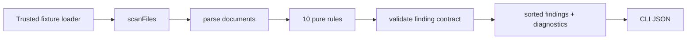

# Design: Scanner and Rule Engine

## Boundaries
`@gravescan/scanner` is pure over `FixtureFile[]`. It reads no paths and never runs code. `@gravescan/cli` calls the trusted fixture loader, then calls scanner. The web UI will do the same in Spec 05.



## Public types

```ts
type Severity = "critical" | "high" | "medium" | "low";
type Confidence = "high" | "medium" | "low";
type Finding = {
  id: string; ruleId: RuleId; severity: Severity; title: string;
  description: string; file: string; line: number; evidence: string;
  remediation: string; confidence: Confidence; attackScenarioId?: string;
};
type Diagnostic = { file: string; line: number; message: string; code: "MALFORMED_JSON" | "UNSUPPORTED_DOCUMENT" };
type ScanResult = { findings: Finding[]; diagnostics: Diagnostic[] };
```

The finding ID is stable: `ruleId:file:line`. A duplicate rule hit on the same line is collapsed.

## Parsing

- `.json`: `JSON.parse`; parse failure becomes `MALFORMED_JSON` at a calculated line. Rules that need JSON receive an `unknown` value only when parsing succeeded.
- `.md`, `.yaml`, `.yml`, and other text: preserve raw content. Markdown/YAML rules use line-based evidence; this avoids treating untrusted content as executable instructions.
- Rules never mutate documents.

## Rules

| ID | Input and detection | Severity | Patch intent |
|---|---|---:|---|
| 001 | enabled MCP JSON `autoApprove` contains shell/execution names | High | remove approval; require user approval |
| 002 | enabled MCP server has no non-empty `tools`/`toolAllowlist`/`allowedTools` array | High | add an explicit minimum allowlist |
| 003 | hook command is not a full match for an approved `pnpm` script plus plain arguments; any shell syntax (`&&`, `;`, `\|`, `$`, backtick, `>`) fails | High | replace with fixed allowlisted command |
| 004 | hook command expands `$SAVED_FILE`, `$INPUT`, or `{{input}}` | Medium | remove interpolation; use validated fixed input |
| 005 | steering text asks to print/export secrets, credentials, or environment variables | Critical | remove secret request and reaffirm boundary |
| 006 | steering text grants any-machine/path-outside-workspace access | High | restrict access to workspace-relative paths |
| 007 | agent JSON includes a network capability or web tool but does not state a reason | Medium | remove it or document business reason |
| 008 | internal finding contract validator sees missing remediation | Low | add concrete remediation before returning finding |
| 009 | config assignment contains a secret-like key and a non-placeholder value, including fake canaries | High | move to environment reference or delete demo value |
| 010 | no steering file has a `Sandbox policy` heading (specs and other docs do not count, because the agent does not load them as guidance) | Medium | add `.kiro/steering/sandbox-policy.md` |

For MCP server structure, `disabled: true` excludes GRAVE-001 and GRAVE-002. This lets GraveScan's own disabled development MCP config remain clean.

## API

```ts
scanFiles(files: readonly FixtureFile[]): ScanResult
scanFixture(id: string): Result<ScanResult, FixtureError>
RULES: readonly RuleDefinition[]
```

`RuleDefinition` receives immutable `ScanDocument[]` and returns findings. The rule engine invokes every rule in ascending ID order, validates outputs, deduplicates by ID, and sorts. GRAVE-008 is a post-rule contract check, so it is active without being a normal content matcher.

## CLI

```
gravescan scan --fixture unsafe-mcp --format json
```

Only `--fixture` is accepted. `--target` is rejected deliberately: the public MVP has controlled fixtures only.

```
gravescan self-scan --format json [--fail-on <severity>]
```

`self-scan` reads this repository's own `.kiro/` through `loadProjectKiro()` in `@gravescan/fixtures`. The root comes from the package location, never from an argument. It reads `.json`, `.md`, `.yaml`, `.yml`, and `.txt` files, rejects symlinks, and stops at 1 MiB per file or 500 files. It is CLI-only and is not exposed in the web UI. `--fail-on` exits 1 when a finding meets the threshold, which lets the Kiro hook and CI enforce it.

## Tests

- Rule tables use synthetic files for positive and negative cases.
- Integration tests scan each controlled fixture.
- fast-check properties generate arbitrary file content and verify no throws, determinism, and valid finding references.
- CLI tests assert JSON output and strict option rejection.
