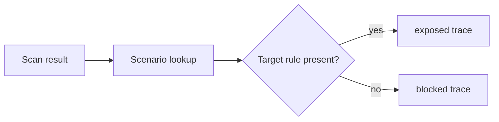

# Design: Safe Attack Simulator

The simulator treats findings as facts and returns a pre-authored state-machine trace. It never examines or runs commands from a fixture.

`AttackScenario` declares the target rule and static steps. `replayScenario(scanResult, id)` selects the same static path every time:

- target finding exists: `exposed`, policy decision says the unsafe capability is available;
- target finding absent: `blocked`, policy decision says no unsafe capability was found.

Result evidence is a sorted projection of matching findings: rule ID, file, line, and evidence. There is no time, random value, subprocess, HTTP client, file read, or eval API in this package.

| Scenario | Target rule | Capability request |
|---|---|---|
| MCP-TOOL-ESCALATION | GRAVE-001 | `shell-capable MCP tool` |
| HOOK-INPUT-EXECUTION | GRAVE-003 | `execute interpolated hook command` |
| STEERING-SECRET-EXPOSURE | GRAVE-005 | `expose a secret or environment value` |
| STEERING-FILESYSTEM-ESCAPE | GRAVE-006 | `read or write outside the workspace` |

Four or fewer static steps explain the request, inspected policy/finding, decision, and final state. The UI presents the required safety notice verbatim.
