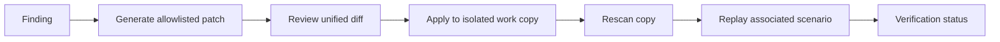

# Design: Patch and Verification Loop



The patcher receives a validated `WorkCopy`, never a fixture root. It reconstructs the expected root from the fixture ID and work base before reading or writing.

## Patch contract

```ts
type Patch = {
  id: string; findingId: string; ruleId: RuleId; file: string;
  before: string; after: string; diff: string; reason: string; riskNote: string;
  baselineHighCritical: number; attackScenarioId?: string;
};
```

Patches are content replacement operations. Applying one verifies that the current file is exactly `before`; if it is already `after`, application is a no-op. Any other state becomes `PATCH_CONFLICT`. This establishes idempotence without running code from patch content.

## Allowlisted transformations

| Rule | Transform |
|---|---|
| 001 | remove shell-capable item from `autoApprove` |
| 002 | add `tools: ["read_file"]` to the identified MCP server |
| 003 / 004 | replace unsafe hook command with `pnpm test` |
| 005 | replace the risky steering line with a non-disclosure boundary |
| 006 | replace broad path grant with workspace-only access |
| 009 | replace value with `${API_TOKEN}` |
| 010 | create `.kiro/steering/sandbox-policy.md` |

GRAVE-007 is intentionally unsupported until the product defines a user-approved reason model. GRAVE-008 never reaches patch generation because it is an internal scanner contract failure.

## Verification state

- High/Critical count above baseline: `Regression detected`.
- Original finding remains, or associated replay remains `exposed`: `Needs review`.
- Finding is gone and associated replay is `blocked`: `Simulation blocked`.
- Finding is gone without a scenario: `Verified`.

`Simulation blocked` is a success state; it names the evidence that makes the security improvement credible. The UI will render it in verified green.
