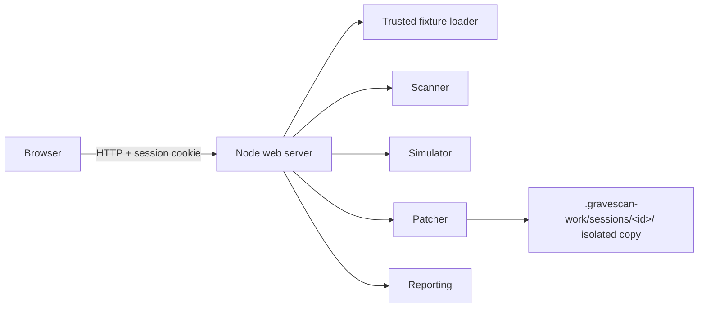

# Design: Product UI and Demo Flow

## Design Read
Reading this as: security workbench for developers and technical judges, in a forensic incident-room visual language, dial ENERGY 2 / RHYTHM 3 / MOTION 1.

## Runtime decision: Node HTTP server, not Next.js

The PRD planned Next.js. The project keeps a dependency-free Node 22 `http` server in `apps/web/src/server.ts`. It started as a workaround while the sandbox had no npm registry access. With the registry available, the decision was re-evaluated and kept for these reasons:

- **The demo needs a persistent process.** Each visitor's isolated copy lives on local disk under `.gravescan-work/sessions/<id>/`, and generated patches live in memory until applied. Serverless functions (the default Next.js deployment target) do not share memory or local disk between requests, so generate-then-apply would break.
- **Smaller attack surface.** The server has exactly six static and health routes plus six POST API routes, with no framework routing, middleware, or server components to audit.
- **It is verified.** Unit, HTTP integration, and Playwright e2e tests cover every route and control.

Migrating to Next.js would only pay off with a persistent Node host and a component-heavy UI, neither of which the MVP needs.

## Visitor isolation

A public demo URL is shared by every judge, so one visitor's patch must not change another visitor's results.

- The first POST issues a random `gravescan_session` cookie: `HttpOnly; SameSite=Strict; Path=/`, plus `Secure` when the request arrived over HTTPS through a proxy.
- Each session has its own work-copy base, fixture baselines, applied-patch log, and patch map.
- At most 50 sessions are kept. The least recently used session is evicted and its directory is deleted.
- On startup the server deletes the sessions directory, because copies from a previous process have no live session.
- The work root must sit inside `.gravescan-work` or the OS temp directory, so a misconfiguration cannot point recursive deletion at an arbitrary path.

## Screen structure

- Header: text wordmark, current state, theme toggle. The text wordmark avoids inventing a logo asset.
- Fixture rail: three named controlled fixtures and a reset action.
- Evidence board: scan action, filters, and findings list. Finding rows use a connected evidence marker to show the relationship between finding, replay, and patch.
- Case detail: selected finding's evidence, replay trace, diff, apply action, and verification report with resolved and introduced findings compared with the first scan.

On narrow screens, these regions stack in the same DOM order. Rebuilding a list keeps keyboard focus on the same item.

## State and API

| Route | Method | Behavior |
|---|---|---|
| `/healthz` | GET | Liveness probe for hosting and Docker |
| `/api/fixtures` | GET | Returns fixed fixture IDs |
| `/api/scan` | POST | Creates or resets the visitor's isolated copy and records it as the baseline |
| `/api/replay` | POST | Replays an associated static scenario against the current copy |
| `/api/patch/generate` | POST | Finds a scan finding and generates an allowlisted patch |
| `/api/patch/apply` | POST | Applies a stored patch, verifies it, and returns a comparison with the baseline |
| `/api/report` | POST | Returns a Markdown before/after report built by `@gravescan/reporting` |
| `/api/reset` | POST | Restores a fresh isolated copy, clears its patch log, and scans it |

Static responses carry a Content Security Policy limited to same-origin scripts, styles, and requests. No user input reaches filesystem path resolution or command execution.

## Finding identity across patches

Finding IDs include the line number, and a JSON patch can reformat a file. Before/after comparison therefore matches findings by rule, file, and evidence text, and patch verification counts the rule's findings in the target file. A patch that only moves the risky line is reported as `Needs review`, not as a fix.

## Design decisions
See `docs/design-decisions.md`. It records one-line reasons for palette, typography, layout, spacing, evidence motif, and motion.
