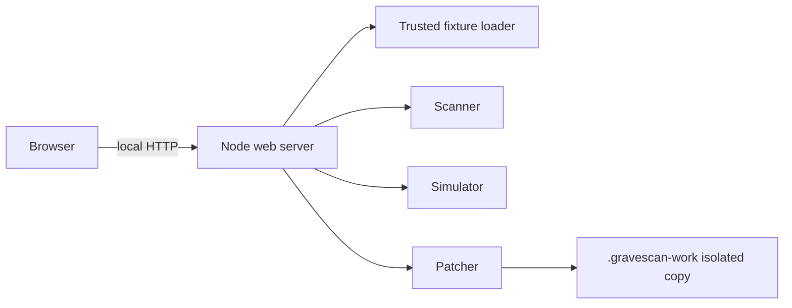

# Design: Product UI and Demo Flow

## Design Read
Reading this as: security workbench for developers and technical judges, in a forensic incident-room visual language, dial ENERGY 2 / RHYTHM 3 / MOTION 1.

## Runtime
The server is `apps/web/src/server.ts`, using Node's `http` module. It serves three exact static routes and a small local API. It has no repository upload route, shell execution, eval, or network client. This is a deliberate sandbox-compatible runnable demo while npm registry access is unavailable; migration to the planned Next.js runtime remains open.

## Screen structure

- Header: text wordmark, current state, theme toggle. The text wordmark avoids inventing a logo asset.
- Fixture rail: three named controlled fixtures and a reset action.
- Evidence board: scan action, filters, and findings list. Finding rows use a connected evidence marker only to show the relationship between finding, replay, and patch.
- Case detail: selected finding's evidence, replay trace, diff, apply action, and verification report.

On narrow screens, these regions stack in the same DOM order. There is no hidden navigation or mouse-only interaction.

## State and API

| Route | Method | Behavior |
|---|---|---|
| `/api/fixtures` | GET | Returns fixed fixture IDs |
| `/api/scan` | POST | Creates/resets an isolated copy, scans it |
| `/api/replay` | POST | Replays an associated static scenario against current copy |
| `/api/patch/generate` | POST | Finds scan finding and generates an allowlisted patch |
| `/api/patch/apply` | POST | Applies stored patch then verifies it |
| `/api/reset` | POST | Restores fresh isolated copy then scans it |

The browser keeps presentation state only. The server stores generated patch sessions in memory. No user input reaches filesystem path resolution or command execution.

## Design decisions
See `docs/design-decisions.md`. It records one-line reasons for palette, typography, layout, spacing, evidence motif, and motion.
