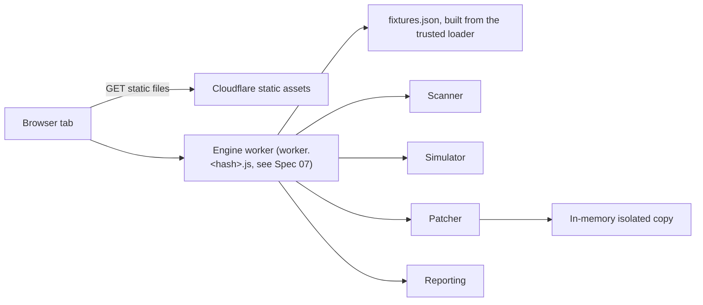

# Design: Product UI and Demo Flow

## Design Read
Reading this as: security workbench for developers and technical judges, in a forensic incident-room visual language, dial ENERGY 2 / RHYTHM 3 / MOTION 1.

## Runtime decision: static site with an in-browser engine

The PRD planned Next.js. The first build used a dependency-free Node 22 `http` server with per-visitor work copies on disk, packaged with a Dockerfile. That needs an always-on container host, which has no free tier that fits a hackathon judged weeks after submission. The project now ships as a static site on Cloudflare Workers static assets, for these reasons:

- **The engine is pure.** Scanning, replay, patch generation, apply, verification, and reporting all operate on `{ path, content }` arrays. Only fixture loading and the CLI's work copies touch the disk, and those stay in the Node entry points. Each package also has a `browser` entry with no Node built-ins, and esbuild bundles them into `dist/assets/engine.js` (about 87 KB minified).
- **Isolation comes by construction.** Each tab creates its own engine, so there is no shared state to evict, leak, or exhaust. The low audit finding about an evicted session's copy being recreated on disk no longer has code to apply to.
- **It is free and has no cold start.** An assets-only Worker runs no script, and static asset requests are free on the Workers Free plan. No database is needed. Supabase was rejected because free projects pause after a week without activity. Durable Objects and Containers were rejected as more moving parts, and Containers need a paid plan.
- **Smaller attack surface.** There are no POST routes, cookies, request bodies, or server-side file paths. The page makes GET requests only for its own static files (the document, the fingerprinted assets, and since Spec 09 the icon set), and the Playwright suite fails if it makes any other request.

## Visitor isolation

A public demo URL is shared by every judge, so one visitor's patch must not change another visitor's results.

- `createEngine(bundle)` snapshots the pristine fixture files once. Each scan or reset copies that snapshot, and patches apply to the copy only.
- Every response is passed through `structuredClone`, so UI code cannot change engine state by editing a returned object.
- State lives in the tab's memory and is gone on reload. Nothing is stored server side.

## Screen structure

Spec 09 replaced this layout and added the owner's logo; see `.kiro/specs/09-editorial-workbench-and-icons/design.md`. The original structure was:

- Header: text wordmark, current state, theme toggle. The text wordmark avoids inventing a logo asset.
- Fixture rail: three named controlled fixtures and a reset action.
- Evidence board: scan action, filters, and findings list. Finding rows use a connected evidence marker to show the relationship between finding, replay, and patch.
- Case detail: selected finding's evidence, replay trace, diff, apply action, and verification report with resolved and introduced findings compared with the first scan.

On narrow screens, these regions stack in the same DOM order. Rebuilding a list keeps keyboard focus on the same item.

## State and actions

`app.js` calls `engine.call(action, payload)`. The action names keep the earlier route names so the UI code did not change.

| Action | Behavior |
|---|---|
| `/api/scan` | Creates or resets the visitor's isolated copy and records it as the baseline |
| `/api/replay` | Replays an associated static scenario against the current copy |
| `/api/patch/generate` | Finds a scan finding and generates an allowlisted patch |
| `/api/patch/apply` | Applies a stored patch with compare-and-set, verifies it, and returns a comparison with the baseline |
| `/api/report` | Returns a Markdown before/after report built by `@gravescan/reporting` |
| `/api/reset` | Restores a fresh isolated copy, clears its patch log, and scans it |

Errors are `EngineError` values with a code and a user-facing message. The build writes `dist/_headers`, which applies a Content Security Policy limited to same-origin scripts, styles, and requests, plus `nosniff`, `Referrer-Policy: no-referrer`, and `X-Frame-Options: DENY`. No user input reaches path resolution or command execution.

## Build and hosting

- `pnpm build` (`scripts/build-web.ts`) writes `dist/`: `index.html`, content-hashed `assets/app.*.js`, `assets/styles.*.css`, `assets/worker.*.js`, `assets/fixtures.*.json`, and `_headers`.
- `pnpm dev` and Playwright serve `dist/` with `scripts/serve-dist.ts`, which applies the same `_headers`.
- `wrangler.jsonc` declares an assets-only Worker named `gravescan`. Workers Builds runs `pnpm build` and `npx wrangler deploy` on each push to `main`.

## Finding identity across patches

Finding IDs include the line number, and a JSON patch can reformat a file. Before/after comparison therefore matches findings by rule, file, and evidence text, and patch verification counts the rule's findings in the target file. A patch that only moves the risky line is reported as `Needs review`, not as a fix.

## Design decisions
See `docs/design-decisions.md`. It records one-line reasons for palette, typography, layout, spacing, evidence motif, and motion.
