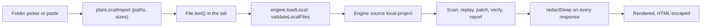

# Design: Scan a Real Project

## Data flow

- `apps/web/src/local-project.ts` holds `planLocalImport`, which decides from paths and sizes alone which files to read, so large or binary files are never opened. It also holds `validateLocalFiles`, which re-checks the decoded files at the engine boundary.
- The engine keeps the visitor's files as one more source, `local-project`, beside the bundled fixtures. It uses the same snapshot, reset, and patch maps.
- The CLI reuses `loadProjectKiro(root)`, which already rejects symlinks and enforces file count and size limits.

## Redaction at the output boundary

Findings keep the raw source line as evidence, because patch generation and before/after matching compare against the real file text. Redaction runs on the way out: `respond()` in the engine and `report()` in the CLI apply `redactDeep`. One function, `redactSecrets` in `packages/scanner/src/secrets.ts`, is the single source for what counts as secret-like.

## Linear-time matching

The earlier GRAVE-009 expression, `[a-z0-9_]*(?:token|secret|...)[a-z0-9_]*`, backtracked quadratically: one 10 KB line of `token` repeated took 43 seconds. The replacement matches a whole key word that starts at a word boundary, then checks the key name in code. Token-format patterns start only where the previous character cannot extend the token, so a long run has one candidate start. A test scans six hostile 200 KB lines and requires each to finish within 1.5 s; the whole file runs in under 100 ms.

## UI

The fixture rail gains a "Your project" section below the fixtures. It holds one folder button, a native `
` for pasting, and a summary line. After loading, a "Your project" entry joins the fixture list and a scan runs at once. Design tokens, button styles, and focus outlines are reused from Spec 05; see `docs/design-decisions.md`.

## Not included

- Scanning a GitHub URL from the page. That would need network access from the page, a token, and a wider CSP.
- Writing patches back to the visitor's disk. The visitor reviews the diff and applies it themselves.
