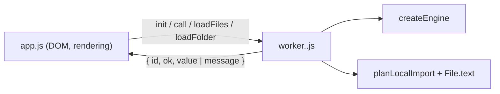

# Design: Worker Engine, Triage Order, and Code Scanning

## Measurements that drove this spec

Lab, Chromium headless, 500-file `.kiro/` project (about 5 MB) given to the folder input from inside the page. Long tasks are counted only after test setup finishes. Two runs each, ranges shown.

| | Before (engine on main thread) | After (engine in worker) |
|---|---|---|
| Longest main-thread task, load and scan, CPU 1x | 102 to 124 ms | none over 50 ms |
| Longest main-thread task, load and scan, CPU 4x | 296 to 309 ms | none over 50 ms |
| Generate patch, CPU 4x | 287 ms, all on the main thread | 43 to 44 ms, in the worker |
| Apply patch, CPU 4x | 291 to 300 ms, all on the main thread | 43 to 45 ms, in the worker |
| Cold load CLS (4x CPU, ~slow 4G) | 0.0175 | 0.0000 (three runs) |
| Fixtures request starts | after the engine downloaded (~1280 ms) | with the page script (~260 ms) |

The engine timings also dropped because each action now scans once: generate previously ran three full scans and apply two. An earlier measurement through Playwright's `setInputFiles` reported a 473 ms task; most of that was the harness transferring 500 files, not the app.

## Worker boundary

- `worker-protocol.ts` is a plain function of a request, so it is unit tested without a worker. `engine-worker.ts` wires it to `onmessage` and queues requests so state changes never interleave.
- The page posts `File` handles for a chosen folder. The worker plans which `.kiro/` files to read and reads them, so large folders never block input.
- The worker is a classic IIFE bundle. It has no imports, and classic workers are supported everywhere the app runs.
- If the worker crashes, pending requests reject with a reload message.

## Triage order

Sorting is a presentation choice, so it lives in `app.js` (`byRisk`). The engine's order stays file then line, which reports and SARIF rely on for determinism.

## SARIF

`packages/reporting/src/sarif.ts` maps findings to SARIF 2.1.0. Fingerprints use FNV-1a over rule, file, and evidence (the same identity as the before/after report), plus an ordinal for repeats. The CLI redacts before building the log.

## Not included

- Trusted Types. It needs the renderer rewritten from escaped `innerHTML` to DOM builders first.
- A GitHub workflow in this repository. `docs/github-code-scanning.md` gives one for the scanned repository instead.
