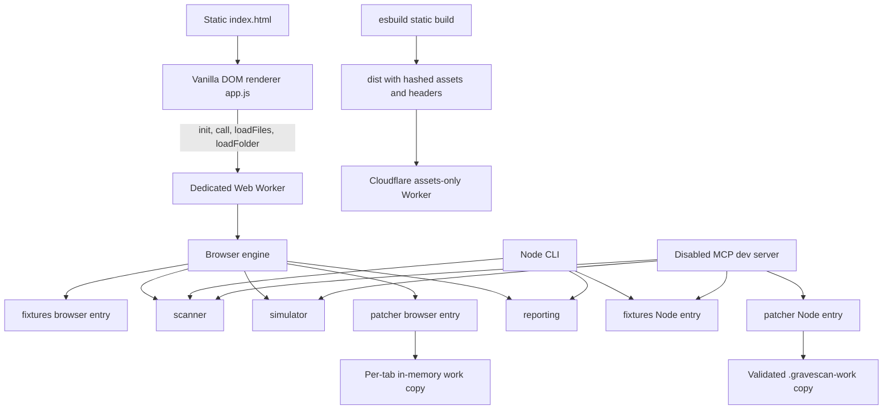
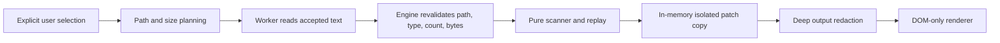

# Design: Production Workbench Redesign

## Status and review gate

Implemented on 2026-11-16. Automated release validation passed. The implementation preserves the owner's evidence-integrity, local-first, Worker-lifecycle, memory-efficiency, and responsive constraints; remaining manual release checks are explicitly documented in `tasks.md` and `docs/ui-delivery-gate.md`.

## 1. Discovery baseline

### 1.1 Product shape

GraveScan is a local-first security evidence workbench for Kiro configuration. It combines three existing capabilities:

1. deterministic static analysis of `.kiro/` text files;
2. bounded, pre-authored attack replay that never executes project code;
3. allowlisted patch generation followed by isolated apply, rescan, replay, and before/after reporting.

The browser application is a public, anonymous, single-page static site. The repository also contains a read-only scanner CLI, SARIF reporting, and a disabled-by-default fixed-function MCP development server.

### 1.2 Repository architecture



#### Application layers

| Layer | Current files | Responsibility |
|---|---|---|
| Static document | `apps/web/src/static/index.html` | Metadata, top bar, masthead, source controls, empty results shell, footer, static fixture buttons |
| Presentation | `apps/web/src/static/styles.css` | Global tokens, dark/light themes, responsive layout, component states, reduced-motion and forced-color behavior |
| Browser interaction | `apps/web/src/static/app.js` | UI state, DOM-only rendering, source actions, filtering, worker requests, downloads, focus retention, theme preference |
| Worker boundary | `apps/web/src/engine-worker.ts`, `worker-protocol.ts` | Queued message handling, local file reading, generic error boundary |
| Browser orchestration | `apps/web/src/engine.ts`, `local-project.ts` | Per-tab source snapshots, scan/replay/patch/report actions, local file validation, output redaction |
| Domain packages | `packages/scanner`, `simulator`, `patcher`, `reporting`, `fixtures` | Pure analysis and replay, allowlisted transformations, reports, safe fixture and project access |
| Node interfaces | `packages/cli`, `packages/mcp-dev` | JSON/SARIF command line and fixed fixture-only MCP tools |
| Build and delivery | `scripts/build-web.ts`, `serve-dist.ts`, `wrangler.jsonc` | Bundling, asset hashing, security headers, local static server, assets-only deployment |

### 1.3 Framework and dependencies

There is no frontend framework, router, CSS framework, component library, server framework, database client, authentication library, or analytics SDK.

| Concern | Current choice |
|---|---|
| Language/runtime | TypeScript and browser JavaScript; Node `>=22.18`; ES modules; browser target ES2022 |
| Workspace | pnpm workspaces, package manager `pnpm@10.26.0` |
| Validation | Zod 3.25.76 from the lockfile |
| Build | esbuild 0.28.2 for the classic Worker bundle; custom Node static build script |
| Unit/integration tests | Vitest 2.1.9 |
| Property tests | fast-check 3.23.2 |
| Browser tests | Playwright 1.62.1, Chromium project |
| Type checking | TypeScript 5.9.3, strict mode, `noUncheckedIndexedAccess`, `isolatedModules` |
| Linting | ESLint 9.39.5 and typescript-eslint 8.72.2 |
| Deployment tooling | Wrangler 4.162.0 |
| Hosting | Cloudflare Workers assets-only deployment; no Worker application script |

All workspace packages are private and currently versioned `0.0.0`.

### 1.4 Routing and page inventory

#### Browser routes

There is one document route:

| Route | Type | Purpose |
|---|---|---|
| `/` | Static document | Entire GraveScan workbench |

The browser also requests fixed public icons and four content-hashed assets: page script, stylesheet, Worker bundle, and fixture JSON.

Strings such as `/api/scan` and `/api/patch/apply` are not HTTP routes. They are action names passed from the page to the in-tab Worker and dispatched synchronously by `createEngine()`.

#### Worker action inventory

| Action | Current behavior |
|---|---|
| `/api/scan` | Resets the selected source to its pristine in-memory snapshot and returns the baseline scan |
| `/api/reset` | Performs the same pristine reset and scan, while clearing patch state |
| `/api/replay` | Scans the current copy and runs a known deterministic scenario |
| `/api/patch/generate` | Scans once, finds the selected finding, and stores an allowlisted patch |
| `/api/patch/apply` | Applies the stored patch to the in-memory copy, scans once, verifies, and compares with baseline |
| `/api/report` | Builds a Markdown report from baseline, current scan, and applied patch records |

There are no sign-in, account, settings, billing, history, project, or error pages. Browser-native download handles the Markdown export.

### 1.5 Current page structure

The single page currently contains:

1. a sticky top bar with logo, product context, live status, and theme toggle;
2. a split masthead with the main explanation, Read/Replay/Verify summary, and logo aperture;
3. a warm-stone "Choose a case" stage with three fixture buttons, scan/reset actions, folder selection, and pasted `mcp.json` input;
4. a review stage with source context, scan summary, filters, and risk-ordered finding queue;
5. a contrasting case file with evidence, remediation, workflow trail, replay trace, diff, and verification report;
6. a disclaimer footer.

At 920 CSS pixels and wider, the findings queue and case file sit beside each other. At 1200 pixels and wider, source examples and local-project controls also split into columns. The mark appears in the masthead from 720 pixels. Fixture cards move into three columns from 600 pixels.

### 1.6 Existing UI component inventory

The UI has no formal component runtime. Reusable behavior is represented by semantic HTML, CSS classes, and DOM-builder functions.

| Existing component or pattern | Current implementation |
|---|---|
| App shell | `.topbar`, `.shell`, `.masthead`, `.workbench`, `.site-footer` |
| Product identity | `.brand`, local `icon0.svg`, aperture geometry in CSS |
| Global status | `#status-line` with `role="status"` and `aria-live="polite"` |
| Theme control | `#theme-toggle`, `data-theme`, theme preference in `localStorage` |
| Source cards | Static `.fixture-button` controls with `aria-pressed` |
| Local project loader | File input, folder button, native `details`, textarea, inline summary |
| Stage actions | Shared `.primary-button` and `.quiet-button` |
| Scan context | `#triage-context`, `#scan-summary`, severity count list |
| Filters | Native labeled `select` controls |
| Finding queue | Ordered list of generated buttons with `aria-current` |
| Empty/status state | `.state-panel`, `.detail-empty`, inline error text |
| Finding case file | Generated `.detail-section` regions |
| Evidence/diff | Safe `pre > code` nodes; diff lines receive semantic classes |
| Workflow trail | Four-stage ordered list with text and semantic state classes |
| Replay trace | Ordered list of bounded simulator steps |
| Verification comparison | Resolved and introduced finding groups |
| Safe renderer | `node`, `append`, `text`, `button`, `section`, and `evidence` helpers using `textContent` |

### 1.7 Current global styles and tokens

The current CSS already has a coherent token base. The redesign should normalize and document it rather than replace it.

#### Structural colors

| Role | Dark/default value | Light-theme value | Intended use |
|---|---:|---:|---|
| Canvas | `#10100f` | `#e3d8cf` | Page background |
| Ink | `#181715` | `#191715` | Dense evidence and structural surface |
| Raised ink | `#22201e` | `#2a2724` | Elevated dark content |
| Mineral paper | `#e8ddd3` | `#f8f1eb` | Reading surface and primary inverse action |
| Paper soft | `#d8c8bc` | `#e5d7cc` | Evidence block on paper |
| Warm stone | `#aa8b76` | `#b1937e` | Source-selection surface |
| Stone deep | `#795f50` | `#7a6152` | Supporting structural tone |

#### Semantic colors

| Role | Ink-context value | Paper-context value |
|---|---:|---:|
| Active evidence/plum | `#c3a5d7` | `#5c3d70` |
| Danger/exposed | `#ff8b80` | `#9b2820` |
| Verified/blocked | `#75dda4` | `#11633c` |
| Focus | `#f0ccff` | contextual plum on light surfaces |

#### Typography and shape

- Display stack: `ui-rounded`, Arial Rounded, Avenir Next, Trebuchet MS, Noto Sans, then sans-serif.
- Interface stack: platform system sans-serif.
- Machine stack: platform monospace.
- Existing radii: 6, 10, and 16 pixels.
- Existing header heights: 68 pixels, reduced to 62 pixels below 720 pixels.
- Existing container maximum: 1320 pixels.
- Existing control target minimum: 44 pixels; primary scan action is 50 pixels.
- Existing motion: 120 to 180 ms control transitions, 300 to 420 ms one-time result transitions.

### 1.8 API integrations and data lifecycle

The production page has no third-party or application API integration.

- `fetch()` retrieves only the content-hashed fixture JSON from the same origin.
- The page creates one same-origin Worker from a build-time content-hashed URL.
- Folder files and pasted content are posted to the Worker as in-memory values. They are never sent over HTTP.
- Scan state, local files, patches, and verification records live in one tab and disappear on reload.
- Worker requests are queued and handled one at a time in arrival order, so state-changing operations do not interleave. The protocol has no partial-request cancellation message or user-facing cancel action.
- If the Worker emits an unexpected error, the page rejects every pending request with generic reload guidance. Leaving or reloading the document disposes the Worker and its memory through the browser lifecycle.
- Replacing the local project overwrites its pristine snapshot and deletes its current source state, including stored patches. Transient folder entries are not assigned to persistent page state, and export object URLs are revoked after the download click.
- Only the selected theme is persisted in `localStorage`.
- Markdown is generated in memory and downloaded through a temporary object URL.
- The Cloudflare deployment serves files only. It has no application request handler, database, or secret.
- The disabled development MCP server communicates over stdio and accepts controlled fixture IDs only.
- The CLI reads a chosen local `<dir>/.kiro/`, emits JSON or SARIF, and never changes that project.

### 1.9 Authentication and authorization

There is no authentication or authorization in the web application because there is no server-side account or data resource. Every visitor receives the same immutable static assets, and each tab owns its own in-memory state.

The relevant access controls are capability boundaries rather than user roles:

- local files require an explicit browser file-selection gesture;
- only allowed `.kiro/` text paths and bounded sizes enter the engine;
- Worker action inputs are validated;
- patch application is restricted to an in-memory copy;
- Node patch operations are restricted to a validated `.gravescan-work/` copy;
- the MCP server is disabled by default and has fixed tools.

Adding accounts or roles would require a separate identity, tenancy, retention, and authorization design and is outside this spec.

### 1.10 Existing functionality and user journeys

| Journey | Current sequence | Current evidence |
|---|---|---|
| Example fixture | Choose one of three fixtures, run scan, review risk-ordered findings | Playwright and engine tests |
| Local folder | Choose a folder, locate the shallowest `.kiro/`, filter supported files, validate limits, scan automatically | Unit and Playwright tests |
| Pasted config | Open native disclosure, paste `mcp.json`, validate and scan automatically | Playwright test |
| Finding triage | Read source context and counts, filter by severity or rule, select a finding | Playwright tests |
| Safe replay | Select a replayable finding, run a four-step deterministic scenario, see exposed or blocked | Unit, property, engine, and Playwright tests |
| Patch review | Request allowlisted patch, read reason/risk note and unified diff | Patcher, engine, and Playwright tests |
| Isolated verification | Apply to per-tab copy, rescan, replay when associated, compare resolved and introduced findings | Patcher, engine, property, and Playwright tests |
| Export | Download a redacted Markdown before/after report | Reporting, engine, and Playwright tests |
| Reset | Restore source snapshot and clear patch log | Engine and Playwright tests |
| Theme | Toggle dark/light and retain preference locally | Playwright test |
| CLI scan | List fixtures; scan fixture or local project; emit JSON/SARIF; optionally fail on severity | CLI tests and CI workflow |
| Self-scan | Scan repository `.kiro/`, fail on medium or higher | Hook, CI, CLI tests |
| SARIF upload | Generate redacted SARIF and upload with least-privilege GitHub permissions | Dedicated GitHub workflow |

### 1.11 Testing infrastructure

- Vitest discovers package, application, script, integration, and property tests.
- fast-check covers path rejection, fixture determinism, scanner stability, simulator determinism, patch idempotence, no successful high-risk regression, and work-copy isolation.
- Playwright runs a Chromium project against a fresh production build and the local static server.
- Browser tests cover the complete fixture flow, filtering, theme, keyboard basics, four viewport widths, per-tab isolation, paste, folder selection, redaction, hostile markup, same-origin requests, headers, and icon assets.
- Build tests enforce four hashed assets, script budgets, static fixture markup, no HTML injection sinks, public-file collision prevention, and security headers.
- Script tests cover static serving, documentation consistency, and repository readiness.
- CI has separate verify and end-to-end jobs on pull requests and pushes to `main`; failed Playwright traces are retained for seven days.
- Current accessibility automation is targeted rather than comprehensive. Existing tests cover skip-link order, Enter activation, focus retention, target height, overflow, contrast evidence documented from computed checks, reduced-motion CSS, and forced-color styles. There is no checked-in automated accessibility scanner or non-Chromium browser project.

### 1.12 Build and deployment

`pnpm build` performs these steps:

1. removes and recreates ignored `dist/`;
2. bundles the Worker as a minified classic IIFE targeting ES2022;
3. embeds controlled fixtures in a JSON asset;
4. fingerprints Worker, fixture JSON, CSS, and page JavaScript with a twelve-character SHA-256 prefix;
5. rewrites static placeholders in the page and page script;
6. copies fixed-name icons and `manifest.json` while preventing collisions with build outputs;
7. writes `dist/_headers`.

Security headers include a same-origin CSP, Trusted Types requirement, `nosniff`, no-referrer, frame denial, COOP, CORP, and a restrictive Permissions Policy. `/assets/*` is cached for one year as immutable; the document and fixed-name public assets are revalidated.

`wrangler.jsonc` deploys `dist/` as an assets-only Worker named `gravescan`. The compatibility date is `2026-11-01`; preview configuration is present. There is no server code, secret, database, migration, or runtime environment variable.

### 1.13 Discovery findings that affect the redesign

The following are observed gaps, not assumptions:

1. **The production path is visually secondary.** Three fixture cards precede the local-project controls even though repository documentation identifies local scanning as the higher-value real workflow.
2. **Parse diagnostics are counted but not inspectable.** The Worker returns file, line, code, and message, while the page displays only the count.
3. **One action contract is inconsistent.** `GRAVE-007` emits `attackScenarioId: "AGENT-NETWORK-ESCALATION"`, but the simulator schema and catalog contain exactly four other scenario IDs. The current case file therefore labels GRAVE-007 as replayable and the action returns "Replay scenario not found."
4. **Automatic patch availability is learned through failure.** GRAVE-007 intentionally has no allowlisted patch, but the case file initially presents the same "Generate patch" action as patchable rules.
5. **Pasted content remains in the textarea after a successful scan.** It stays local, but clearing it would reduce unnecessary plaintext retention in the document.
6. **Status is split across broad live regions.** The global status is useful, but the whole detail article is also live, which can cause verbose announcements when it is rebuilt.
7. **Documentation has stale boundary statements.** `SECURITY.md` still says GraveScan processes only controlled fixtures, while the implemented page and CLI also read explicitly selected local `.kiro/` text. This is local reading, not upload, but the wording should be exact.
8. **Manifest colors predate the current palette.** `manifest.json` uses `#0d0c13`, while the current canvas and browser theme metadata use newer ink values.
9. **Compatibility evidence is Chromium-centered.** The current automated browser suite has one Chromium project. Any broader browser support claim would need new evidence.
10. **The existing design is already deliberate.** Specs 09 and 10 established the current identity, contrast, content breakpoints, and motion rules. A full visual replacement would add risk without addressing the production workflow gaps above.
11. **Cancellation is lifecycle-based, not an action.** The Worker serializes requests and the page rejects pending requests if the Worker fails; reload disposes all state. There is no request ID cancellation message, abort protocol, or cancel button to preserve or advertise.
12. **Security facts already cross a clear data boundary.** Findings, severities, confidence, evidence, diagnostics, remediation, replay, patch, and verification values come from Worker responses, while source names and explanatory copy are static UI content. The redesign must keep that distinction explicit and must not derive plausible security facts in the presentation layer.

## 2. Design direction

### 2.1 Design read

A private-feeling, local security review desk for developers. Keep ENERGY 3 / RHYTHM 3 / MOTION 2.

The redesign retains the architectural security atelier language while shifting emphasis from demonstration to work:

- the local-project action becomes immediately visible and primary;
- examples remain easy to discover but read as examples;
- the risk summary, queue, and selected evidence form the dominant working surface;
- privacy and capability boundaries are stated at the point of action;
- every visual state maps to engine truth.

The interface must not imitate a generic SaaS dashboard. It has no fake global navigation, account avatar, notification bell, command palette, activity graph, or marketing statistic because none corresponds to product behavior.

### 2.2 Design principles

1. **Engine evidence is the product truth.** Finding facts, confidence, source references, remediation, replay, patch, and verification states come from the active validated engine response. Static copy may explain those facts but may not invent or embellish them.
2. **Evidence before decoration.** File, line, rule, and state remain easier to locate than ornamental treatment.
3. **One next action.** Each stage has one visually dominant action based on the current state.
4. **Local by construction.** Privacy copy appears beside source controls and reflects the actual Worker boundary.
5. **Progressive detail.** The summary answers "what happened" before the queue and case file answer "where" and "what next."
6. **Native interaction first.** Buttons, selects, file input, details, summary, and textarea keep browser semantics.
7. **Existing architecture first.** Reorder and refine the current structures before adding abstractions.
8. **No security theater.** Red and green encode real engine outcomes, and a clean scan never becomes a success claim.

## 3. Information architecture and page redesign

### 3.1 Route `/`: workbench overview

No new page or router is proposed. The single route is reorganized into five visible regions.

#### A. Utility top bar

Retain:

- owner logo and GraveScan name;
- compact "Security evidence workbench" context where space permits;
- concise global status;
- dark/light theme toggle.

Refine:

- reserve the global live region for page-level events such as engine readiness, scan completion, and unrecoverable Worker failure;
- keep action-specific errors beside their action;
- prevent a long status from crowding the brand or theme control on narrow screens;
- align the browser `theme-color` and web app manifest colors with the active palette.

#### B. Compact orientation and trust panel

Retain the local mark and scanning-aperture motif, but reduce promotional dominance. The panel must communicate, in order:

1. what GraveScan examines;
2. the Read, Replay, Verify model;
3. that processing happens in the tab;
4. that no project code runs and no project file is uploaded.

The mark remains optional below the existing content breakpoint. Text must not be displaced merely to preserve the illustration.

#### C. Source workspace

Reorder the existing source choices without removing any behavior:

- **Primary: Scan your project.** The folder button is the dominant action. Pasted `mcp.json` remains the keyboard-accessible fallback in a native disclosure. Scope and limits appear before the controls.
- **Secondary: Try an example.** The three static fixture buttons retain descriptions, disabled loading state, selected state, and no-load-shift behavior.
- **Source state:** active source, accepted file count, skipped oversized count, local-only boundary, and replacement guidance appear in one compact summary.
- **Stage action:** fixture selection enables "Run scan." Local folder and paste continue to scan after validation, preserving current behavior.

A successful paste clears the textarea after the Worker accepts the files. An unsuccessful paste leaves the text so the visitor can correct it.

#### D. Findings workspace

The findings workspace remains the main working surface.

**Summary bar**

- active source and boundary;
- total findings;
- severity distribution;
- parse diagnostic count;
- explicit clean-scan language.

**Diagnostics disclosure**

- appears only when diagnostics exist;
- uses a native `details` element;
- lists diagnostic code, file, line, and safe message;
- clearly labels diagnostics as input parsing issues, not findings.

**Filter bar**

- native severity and rule selects;
- visible result count such as "2 of 4 findings";
- one reset action when filters hide all results;
- disabled until a report exists.

**Finding queue**

- preserves risk ordering and deterministic tie order;
- keeps severity, rule, title, file, line, and replay/static capability label;
- preserves `aria-current`, focus retention, and numbered rows;
- uses density suitable for scanning rather than equal-height cards.

#### E. Case file

The selected case file remains the strongest focal surface. Its order is:

1. severity, rule, location, and confidence;
2. finding title and description;
3. Scan/Replay/Patch/Verify trail with explicit text state;
4. source evidence;
5. recommended boundary;
6. context-sensitive actions;
7. replay trace, patch diff, and verification result in the order produced.

Action language must match capability:

- a finding with one of the four supported scenarios gets "Run safe replay";
- a static-only finding is labeled "Static evidence" and receives no replay button;
- patch generation is framed as availability-limited, for example "Propose safe patch" with supporting text that some findings require manual remediation;
- if no patch exists, the inline result explains that manual remediation is required and does not treat the outcome as a crash.

The whole article should not be a broad live region. A small dedicated status node announces the result of an action, while the visible detail remains ordinary document content. User-triggered scroll may reveal the new section but must not steal keyboard focus from the active control.

#### F. Footer

Retain the no-overclaim statement. Keep the footer quiet and do not add unsupported navigation or company links.

## 4. Layout architecture

### 4.1 Shared frame

- One maximum-width container of 1320 pixels.
- One responsive page gutter token.
- One stage-gap token and one stage-radius family.
- Orientation, source, and review panels align to the same frame.
- Each surface represents a task boundary: paper for explanation, stone for source selection, ink for evidence, contrasting paper or ink for the selected case.

### 4.2 Responsive states

Use content breakpoints close to the current implementation rather than device names.

| Range | Proposed behavior |
|---|---|
| 320 to 599 px | Compact top bar; text-first orientation; local source first; example sources in one column; two filter columns only if labels and options fit, otherwise one column; queue then case file; trail may use two columns |
| 600 to 719 px | Example cases may use three columns; actions stop stretching when readable; local source can split copy and controls |
| 720 to 919 px | Aperture may appear; source content gains more horizontal composition; review remains stacked |
| 920 to 1199 px | Findings queue beside a wider case file; queue may become sticky and independently scrollable only with visible focus and no scroll trap |
| 1200 px and above | Local-project primary panel and examples may form an asymmetric source grid; review keeps queue/detail proportions near 0.8/1.2 |

Breakpoints may move after content testing, but implementation must preserve the observed layout transitions rather than adding arbitrary framework defaults.

### 4.3 Sticky behavior

The findings queue may be sticky only when:

- its maximum height leaves visible space above and below;
- keyboard focus can enter and leave it normally;
- wheel and touch scrolling can continue to the page at its boundary;
- zoomed text does not hide controls;
- the viewport is both wide and tall enough.

At short desktop heights or 200 percent zoom, it should return to document flow.

## 5. Design tokens

### 5.1 Token model

Keep current values as the approved baseline and reorganize aliases by role. Surface-specific aliases avoid repeating raw colors.

```css
/* Primitive surfaces */
--color-canvas;
--color-ink;
--color-ink-raised;
--color-paper;
--color-paper-soft;
--color-stone;
--color-stone-deep;

/* Semantic content */
--color-text;
--color-text-muted;
--color-border;
--color-border-strong;
--color-action;
--color-action-text;
--color-evidence;
--color-danger;
--color-danger-text;
--color-success;
--color-success-text;
--color-focus;

/* Layout */
--space-1: 0.25rem;
--space-2: 0.5rem;
--space-3: 0.75rem;
--space-4: 1rem;
--space-6: 1.5rem;
--space-8: 2rem;
--space-12: 3rem;
--space-16: 4rem;
--page-gutter: clamp(0.75rem, 3.2vw, 2.5rem);
--stage-gap: clamp(0.75rem, 1.6vw, 1.25rem);
--stage-padding: clamp(1.15rem, 3vw, 2.75rem);

/* Shape and interaction */
--radius-small: 6px;
--radius-medium: 10px;
--radius-large: 16px;
--border-width: 1px;
--focus-width: 3px;
--target-min: 44px;
--duration-press: 120ms;
--duration-control: 180ms;
--duration-result: 360ms;
--ease-standard: cubic-bezier(0.2, 0.75, 0.2, 1);
```

The implementation may preserve existing token names when renaming would create needless churn. The requirement is semantic reuse, not a naming migration for its own sake.

### 5.2 Color system

- **Ink** contains dense review work and provides the stable top bar.
- **Paper** contains explanatory or selected long-form reading.
- **Stone** separates source selection from evidence review.
- **Plum** appears on selected source/finding indicators, evidence trail progress, focus where contrast permits, and the aperture scan line.
- **Danger red** appears on critical/high severity and exposed or failed verification states.
- **Success green** appears only when replay is blocked or a patch is verified.
- Neutral borders and text carry pending, unavailable, low severity, and ordinary structure.

No gradient is needed outside the existing owner-provided logo. CSS `color-mix()` may continue for restrained state fills where the supported-browser baseline permits it.

### 5.3 Typography system

| Role | Family | Size behavior | Use |
|---|---|---|---|
| Display 1 | Rounded display | `clamp(2.15rem, 1.3rem + 3vw, 4.35rem)` or a reduced tested maximum | Main heading only |
| Display 2 | Rounded display | approximately 1.55 to 2.2 rem | Stage headings |
| Display 3 | Rounded display | approximately 1.3 to 1.6 rem | Local source and subsection emphasis |
| Case title | Rounded display | approximately 1.7 to 2.75 rem | Selected finding title |
| Body | System sans | 1 rem, line-height at least 1.5 | Main explanation and finding description |
| Interface | System sans | 0.8125 to 0.9375 rem | Labels, actions, metadata, statuses |
| Machine | System mono | 0.75 to 0.875 rem | IDs, paths, evidence, textarea, diff |

Sentence case remains standard. Uppercase is limited to short machine-like or eyebrow labels. Long technical strings may break anywhere only where needed to contain layout; ordinary prose should wrap by word.

## 6. Reusable components

| Component | Structure | Required states | Accessibility contract |
|---|---|---|---|
| `AppHeader` | Brand, context, global status, theme button | loading, ready, busy, success, failure | status is concise and polite; theme button has action label |
| `TrustPanel` | Heading, explanation, process summary, local-only proof | static | one `h1`; image decorative when brand already named |
| `LocalSourcePanel` | Scope copy, folder action, paste disclosure, local summary | idle, loading, accepted, partial, invalid | labeled input/textarea; inline message associated with source control |
| `ExampleSourceList` | Three static source buttons | disabled, unselected, selected | group label; buttons use `aria-pressed` |
| `SourceSummary` | Name, boundary, file counts, replacement guidance | none, fixture, local | plain text; no color-only meaning |
| `ScanSummary` | Finding total, severity counts, diagnostics | no report, clean, findings, diagnostics | heading and list; count changes announced once |
| `DiagnosticsDisclosure` | Native summary and diagnostic list | absent, collapsed, expanded | file, line, code, message available as text |
| `FilterBar` | Two native selects, result count, reset | disabled, active, empty result | explicit labels; reset is keyboard reachable |
| `FindingQueue` | Ordered rows | empty, filtered empty, populated | `aria-current` on selected row; focus restored after render |
| `FindingRow` | Severity, rule, title, path, capability | unselected, selected, focused | entire row is one button; text names state |
| `CaseFile` | Metadata, title, trail, evidence, actions, generated result sections | empty, finding, replay, patch, verification, error | ordered headings; dedicated action status; no broad live article |
| `EvidenceTrail` | Four ordered stages | pending, complete, exposed, blocked, unavailable, needs review, regression | every marker has a visible text state |
| `EvidenceBlock` | `pre > code` | ordinary, diff, overflow | text-only insertion; bounded horizontal scroll where necessary |
| `ActionGroup` | One primary and optional secondary actions | enabled, disabled, busy, unavailable | disabled reason visible; target size at least 44 px |
| `InlineNotice` | Short message and optional recovery action | info, warning, error, success | semantic text and association with triggering region |

These names describe design boundaries. They do not require JavaScript classes or a component framework.

## 7. Interaction and state behavior

### 7.1 State model

Retain the existing explicit state fields:

```text
source -> report -> selected finding -> replay -> patch -> verification
                    busy and error apply to the active transition
```

State invalidation rules:

- changing source clears report, selection, replay, patch, verification, and action error;
- scanning or resetting creates a new report and clears replay, patch, verification, and stale error;
- selecting another finding clears replay, patch, verification, and stale error;
- generating a patch clears an earlier verification for that finding;
- applying a patch refreshes the report and preserves the selected finding as historical context only where current behavior requires it;
- loading a new local project replaces the previous local snapshot and patch map;
- reload clears all state except theme.

### 7.2 Action hierarchy

| State | Primary action | Secondary actions |
|---|---|---|
| No source | Choose project folder | Paste config, choose example |
| Example selected | Run scan | Choose another source |
| Report ready | Inspect selected finding | Filter, export, reset |
| Replayable finding | Propose safe patch | Run safe replay |
| Static finding | Propose safe patch | None, or manual-remediation explanation |
| Patch ready | Apply to isolated copy | Return to evidence or select another finding |
| Verification complete | Review result | Export, inspect remaining finding, reset |

The exact button order may adapt by width, but semantic priority must remain consistent.

### 7.3 Scrolling and focus

- Preserve the current `reveal()` principle: show new user-triggered results only when outside the useful viewport.
- Do not move focus merely because content appeared.
- Keep focus on a source or finding button when its list rerenders.
- If an input validation error occurs, focus the invalid input when that is the fastest recovery, as the empty-paste path already does.
- If a Worker fails irrecoverably, announce reload guidance and leave focus in a predictable place.

### 7.4 Motion

- No initial masthead animation.
- Control feedback stays within 120 to 180 ms.
- New scan rows, replay steps, and verification result may enter once within 300 to 360 ms.
- No loop, autoplay, parallax, animated counter, or scroll-driven effect.
- `prefers-reduced-motion: reduce` removes smooth scrolling and nonessential transforms/fades.
- Information appears immediately even when animation is enabled; motion cannot delay access to content.

## 8. Technical implementation strategy

### 8.1 Keep the existing runtime

The redesign should primarily touch:

- `apps/web/src/static/index.html` for hierarchy and static source markup;
- `apps/web/src/static/styles.css` for semantic tokens, layout, states, and responsive behavior;
- `apps/web/src/static/app.js` for diagnostics, filter counts, local-input cleanup, refined announcements, capability wording, and rendering state;
- focused tests under `tests/e2e/` and `scripts/build-web.test.ts`;
- documentation that describes the UI and security boundary.

The Worker, engine route names, domain packages, build topology, deployment, and CLI remain unchanged except for the direct GRAVE-007 contract correction.

### 8.2 Proposed GRAVE-007 correction

The existing simulator is explicitly specified to have four scenarios, and no `AGENT-NETWORK-ESCALATION` scenario exists. The smallest non-expanding correction is:

- remove the unsupported `attackScenarioId` from the GRAVE-007 finding;
- render it as static evidence;
- retain its severity, description, remediation, and intentionally unsupported automatic patch behavior;
- add a regression assertion that every emitted `attackScenarioId` resolves in the simulator catalog.

Adding a fifth scenario would broaden simulator requirements and must not happen under this redesign without separate approval.

### 8.3 Renderer strategy

Continue to create dynamic content with `document.createElement`, `textContent`, fixed attributes, and event listeners. Extend the current helpers only where repeated diagnostics or notice markup warrants it.

Do not introduce:

- HTML template strings for untrusted data;
- runtime markdown rendering;
- a virtual DOM;
- client-side routing;
- a generic event bus;
- state persistence for file content;
- a remote icon or font request.

### 8.4 Evidence provenance and transparency

The presentation layer may sort, filter, count, group, and label values from the active engine result. It may not manufacture domain facts.

| Rendered information | Authoritative source |
|---|---|
| Finding ID, rule, severity, confidence, source, line, evidence, description, remediation | `state.report.findings` from the redacted Worker response |
| Parse diagnostic code, source, line, and message | `state.report.diagnostics` from the redacted Worker response |
| Replay capability, policy, steps, evidence, result, and safety notice | `state.replay` from the Worker response |
| Patch file, reason, risk note, diff, and identifier | `state.patch` from the Worker response |
| Verification status, target presence, before/after values, comparison, and replay | `state.verification` from the Worker response |
| Finding and severity totals | A deterministic aggregation of the active `state.report`, recomputed after every report change |
| Source display name and privacy explanation | Fixed product copy mapped to the validated source ID; never presented as scan evidence |
| Empty, loading, unsupported, and error explanations | Fixed interface copy describing state; never presented as a finding or validation result |

Implementation rules:

- no UI default may substitute a severity, confidence, line, evidence excerpt, remediation, replay result, or verification status when the corresponding value is absent;
- unavailable or unverified values render as unavailable or unverified;
- source changes and reports invalidate all derived counts, selections, and later workflow stages before rerender;
- sorting cannot mutate the engine report;
- static explanations must be visually and semantically distinct from evidence;
- test assertions must compare rendered facts with the exact active Worker fixture rather than expected-looking prose alone.

### 8.5 Static-markup strategy

Keep meaningful first-load content and all known example controls in `index.html`. This provides orientation before JavaScript initializes and preserves zero layout shift for fixture discovery. JavaScript updates controls in place rather than replacing the source region.

### 8.6 Stylesheet strategy

Refactor only while implementing approved visual changes:

- group primitive, semantic, and component tokens;
- keep surface-scoped aliases for ink, paper, and stone;
- preserve existing contrast-tested values unless a measured change is necessary;
- use mobile-first content breakpoints;
- keep hover rules under `@media (hover: hover)`;
- preserve forced-colors and reduced-motion sections;
- avoid selector rewrites unrelated to the new hierarchy.

### 8.7 Diagnostics strategy

`state.report.diagnostics` already contains the required data. The UI can render it without a Worker or schema change:

```text
Parse diagnostics (2)
  MALFORMED_JSON
  .kiro/settings/mcp.json:7
  Invalid JSON. Static JSON rules were skipped for this file.
```

Diagnostic strings pass through the same redacted Worker response and DOM-only renderer as findings.

### 8.8 Privacy cleanup

On successful `loadFiles` acceptance:

- clear the pasted textarea value;
- retain only the validated Worker copy in tab memory;
- show a summary that reload clears local files;
- never store pasted or selected file content in web storage.

On validation failure, retain the textarea to permit correction and show the inline error.

### 8.9 Documentation alignment

Update documentation only to reflect approved behavior:

- add Spec 11 to `.kiro/specs/README.md` with proposed status;
- update `SECURITY.md` so it distinguishes explicit browser-local selection and CLI reads from upload;
- update `docs/design-decisions.md` with only decisions that actually ship;
- update `docs/ui-delivery-gate.md` with measured evidence after implementation;
- correct stale spec counts in `docs/kiro-workflow.md` when that file is next touched by the approved tasks;
- align manifest and metadata colors with the final tokens.

## 9. Accessibility design

### 9.1 Semantics

- Keep a single `h1` in the orientation panel.
- Use `h2` for source, findings, and case file; use ordered `h3` headings inside the case file.
- Keep source examples in a labeled group and findings in an ordered list.
- Use `details`/`summary` for optional paste and diagnostic disclosure.
- Use native select labels and visible text rather than placeholder-only labels.
- Avoid redundant `role` values on elements with equivalent native semantics.

### 9.2 Announcements

Use separate channels:

- **Global polite status:** engine readiness, scan completion, reset completion, Worker failure.
- **Source inline status:** accepted files, skipped files, validation errors.
- **Case action status:** replay, patch, and verification completion or error.
- **Static document content:** finding detail, evidence, trace, diff, and comparison.

Only the short status message is live. Rebuilding a long article must not cause a screen reader to announce the entire content.

### 9.3 Contrast and non-color state

Every semantic color has a paired word or count. Verify all combinations created by both themes and surface inversions, including:

- muted text on stone;
- focus ring against ink, paper, and stone;
- danger and success chips;
- selected source/finding fills and borders;
- added, removed, and header diff lines;
- disabled controls;
- links or summary markers if introduced.

### 9.4 Zoom and reflow

At 200 percent zoom, disable sticky or multi-column behavior when it obscures content. Code and diff blocks may scroll horizontally within their own region; the page itself may not require horizontal scrolling.

## 10. Performance design

### 10.1 Keep work off the main thread

No scan, file read, patch, verification, or report work moves back into `app.js`. UI changes should perform linear rendering over returned findings and diagnostics. Repeated scans must not be introduced during render.

### 10.2 Worker lifecycle and cancellation semantics

Preserve the current behavior exactly unless a later approved spec introduces cancellation:

1. the page assigns an ID to each request and stores its resolver;
2. the Worker queues requests in arrival order;
3. each request completes before the next state-changing request begins;
4. a normal request resolves or rejects once;
5. an unexpected Worker error rejects every pending page request with generic reload guidance;
6. document unload or reload disposes the Worker and all pending in-memory work through the browser lifecycle.

There is no protocol message that cancels an individual request and no engine rollback model for a partially completed state change. The redesign must therefore preserve responsive busy feedback but must not add or advertise a cancel button. A true cancel action would require explicit request states, safe checkpoints, rollback rules, race tests, and separate approval.

### 10.3 Memory-efficiency strategy

Keep memory proportional to the bounded active workflow:

- retain the existing 500-file, 1-MiB-per-file, and 5-MiB-total local source limits;
- keep project contents in the Worker, not a second page-level content model;
- replace the prior local pristine snapshot and delete its active state when new local files are accepted;
- do not retain `File` or folder-entry objects after their load request completes;
- use `replaceChildren()` or equivalent replacement so obsolete rendered evidence is detached rather than appended indefinitely;
- keep no scan-history, telemetry, analytics, or error-reporting queue;
- revoke Markdown object URLs immediately after initiating download;
- retain only the existing bounded fixture/source states and patch records needed by the active per-tab workflow.

Verification should use repeated local-project replacement and scan/reset cycles, Worker/state assertions, and browser heap snapshots where the environment supports them. Garbage collection timing makes a single exact heap ceiling unreliable, so evidence must report the method and observed trend rather than inventing a precise memory claim.

### 10.4 Asset and request budget

- Keep four fingerprinted build assets.
- Keep the page script below 25 KiB uncompressed.
- Keep the Worker below 125 KiB uncompressed.
- Do not add font, icon, image, stylesheet, analytics, or API origins.
- Keep the fixture preload and static source buttons.
- Preserve intrinsic dimensions for the logo and icon assets.

### 10.5 Measurement

Use the existing production build and local static server. Record:

- built asset byte sizes;
- request list and origin;
- layout shift from cold load;
- main-thread long tasks during the 500-file flow at 4x CPU;
- first-in, first-out Worker completion for state-changing requests and safe rejection of all pending requests on Worker failure;
- repeated local-project replacement and scan/reset memory behavior, including retained Worker state and heap trend where measurable;
- LCP, INP proxy or interaction latency, and CLS as lab values;
- viewport-specific overflow and target-size results.

Label lab results as lab results. This static product has no approved telemetry, so field percentiles remain unverified unless the owner separately approves a privacy-preserving measurement plan.

## 11. Security design

The redesign must preserve these trust boundaries:



Required controls:

- same-origin static network allowlist;
- no upload endpoint, form submission, analytics, telemetry, external error reporting, AI service, or hosted storage;
- no transmission of local paths, source content, findings, evidence, diffs, reports, or derived scan artifacts to an external service;
- no shell, eval, dynamic import from user input, or simulator network client;
- generic unexpected-error handling;
- strict local file bounds and path validation;
- redaction before UI, report, CLI, and SARIF output;
- evidence provenance from the active validated Worker result, with unknown and unsupported states represented honestly;
- compare-and-set patch application;
- exact Trusted Types policy for the build-time Worker URL;
- existing CSP and response headers;
- no storage of project content outside tab memory.

## 12. Alternatives considered

### 12.1 Migrate to React, Next.js, or another frontend framework

Rejected for this scope. The current page is one route, has a small explicit state model, and already has safe DOM builders. A migration would add dependencies, bundle cost, new security review surface, and behavior risk without solving the observed workflow issues.

### 12.2 Add a hosted backend and account system

Rejected. It would change the strongest privacy guarantee and require identity, authorization, tenancy, retention, encryption, audit, rate-limit, and incident-response designs.

### 12.3 Add local scan history

Deferred. Even metadata-only history needs a clear delete control and privacy contract. This redesign retains theme-only persistence.

### 12.4 Add direct repository patch write-back

Rejected. The current in-memory proof and reviewed diff preserve safety. Write-back belongs in a local extension or separately designed CLI workflow.

### 12.5 Replace the established art direction

Rejected. The current design has owner-approved identity, measured contrast, responsive evidence, and no external visual dependency. The redesign should improve production task order and state clarity rather than repaint the product.

### 12.6 Add an in-flight cancel button

Rejected for this scope. The current Worker stays responsive by moving bounded work off the main thread and serializes state changes, but it has no safe partial-request cancellation or rollback protocol. Advertising cancellation without that protocol would be inaccurate. Reload remains the lifecycle reset for an unexpected stuck or failed Worker.

## 13. Risks and mitigations

| Risk | Mitigation |
|---|---|
| Reordering sources breaks the hackathon demo path | Keep all three examples visible and static; retain the same IDs and scan action; test both local and fixture first-run journeys |
| More summary content increases density | Use progressive disclosure for diagnostics and concise counts; keep selected evidence as focal content |
| Sticky queue traps scrolling or breaks zoom | Gate sticky behavior by width and height; test keyboard exit, wheel/touch boundary behavior, and 200 percent zoom |
| Additional live regions become noisy | Use one short status node per scope and remove live behavior from long rerendered content |
| Token cleanup causes widespread visual regressions | Preserve current values, migrate by surface, and compare screenshots at each phase |
| Capability correction changes snapshots | Limit the change to unsupported GRAVE-007 metadata and add catalog consistency coverage |
| UI-derived labels drift from engine truth | Define provenance for every security fact, clear stale state before rerender, and compare rendered values with exact Worker responses |
| "Preserve cancellation" is mistaken for a cancel feature | Document that current cancellation is Worker failure or page lifecycle disposal only; add no cancel control without a separate protocol design |
| Repeated local imports retain obsolete content | Replace the local pristine/current state, release transient file references, revoke object URLs, and inspect repeated-cycle heap/state evidence |
| Clearing pasted input surprises users | Clear only after successful Worker acceptance and explain that source content lives in the active tab until reload |
| Performance regresses through richer rendering | Keep linear DOM rendering, existing asset budgets, and long-task measurement as blocking acceptance checks |
| Broader browser claims lack evidence | State the tested matrix exactly and do not claim unsupported coverage |

## 14. Verification strategy

### 14.1 Automated

- Existing scanner, simulator, patcher, reporting, fixture, engine, CLI, integration, property, build, and static-server tests.
- Focused test for emitted replay IDs resolving in the four-scenario catalog.
- Provenance assertions that rendered finding, diagnostic, replay, patch, comparison, and verification facts equal the active redacted Worker result, with absent values rendered as unavailable rather than defaulted.
- Worker-protocol coverage for first-in, first-out state changes, no interleaving, generic unexpected errors, and page-side rejection of every pending request on Worker failure.
- Local-project replacement coverage proving prior patch state is invalidated and no page-level project-content history or persistent store is introduced.
- Build test for no HTML injection sinks and unchanged security headers.
- Browser paths for local-primary orientation, examples, diagnostics, filters, static-only finding state, supported replay, patch failure, successful verification, export, reset, and both themes.
- Browser viewport checks at 320, 390, 768, 1024, 1280, and 1440 pixels.
- Same-origin request allowlist and console-error checks.

### 14.2 Manual

- Compare empty, loading, clean, findings, filtered-empty, diagnostics, replay, diff, verified, needs-review, regression, unavailable, unsupported, and error states.
- Trace every rendered security fact in representative flows to the active Worker response or clearly labeled static copy; verify that missing values remain visibly unavailable.
- Repeat local-project replacement and scan/reset cycles, inspect retained state and heap trend where supported, and verify reload disposal.
- Keyboard-only walkthrough from skip link through source, filters, queue, case actions, theme, and reset.
- Screen-reader smoke check for headings, selected states, concise announcements, error associations, and workflow state.
- 200 percent zoom and text reflow.
- Reduced motion and forced colors.
- Contrast checks for every changed text, boundary, focus, danger, success, and diff combination.
- Pointer and touch-size inspection.

### 14.3 Release gate

Implementation is complete only when:

1. every approved task has evidence;
2. all commands in Requirement R10.3 pass;
3. responsive and accessibility evidence is recorded in `docs/ui-delivery-gate.md`;
4. production build requests and headers match the security contract;
5. final diff review finds no unrelated refactor or feature;
6. unresolved limitations are listed rather than hidden.

## 15. Requirement traceability

| Design area | Requirements | Acceptance criteria |
|---|---|---|
| Source workspace | R1, R2 | AC-01, AC-02 |
| Findings, diagnostics, and evidence provenance | R3 | AC-03, AC-04, AC-13 |
| Visual system | R4 | AC-05 |
| Responsive layout | R5 | AC-06 |
| Accessibility | R6 | AC-07 |
| Performance, Worker lifecycle, and memory | R7 | AC-08, AC-14 |
| Security and privacy | R8 | AC-09, AC-13 |
| Architecture | R9 | AC-10 |
| Verification | R10 | AC-11, AC-12 |
