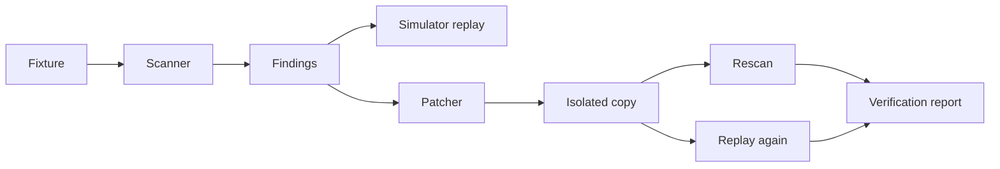

# Architecture

Packages: `scanner`, `simulator`, `patcher`, `reporting`, `fixtures`, and `mcp-dev`. The CLI uses their Node entries, which read fixtures and write work copies on disk. The web workbench uses their `browser` entries, which have no Node built-ins: `apps/web/src/engine.ts` runs the fixed fixture, replay, and patch actions in the visitor's tab, and `pnpm build` bundles it with esbuild into a static site that Cloudflare Workers serves as an assets-only Worker. The dev-only `gravescan-dev` MCP server exposes the same fixed flow over stdio and is disabled by default in `.kiro/settings/mcp.json`.

Full requirements: see the PRD and `.kiro/specs/`.

## Engine worker

The page script (`apps/web/src/static/app.js`) never runs the engine. It starts a dedicated worker built from `apps/web/src/engine-worker.ts` and sends one message per user action: `init`, `call`, `loadFiles`, or `loadFolder`. `apps/web/src/worker-protocol.ts` handles each message in arrival order. Scanning, patching, reading the visitor's files, and redaction all run in the worker. Only engine errors carry user-facing text back to the page; any other error becomes a generic message.

## Static delivery and cache boundary

`pnpm build` fingerprints the engine worker, UI script, stylesheet, and fixture bundle with a SHA-256-derived URL. `dist/_headers` applies the CSP and other security headers to every response, then adds `Cache-Control: public, max-age=31536000, immutable` only to `/assets/*`. `index.html` has no long-lived cache rule, so it receives the new asset URLs on the next request after deploy. `scripts/serve-dist.ts` applies the same header rules locally for Playwright.
