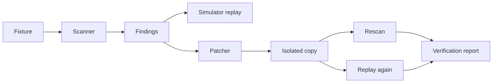

# Architecture

Packages: `scanner`, `simulator`, `patcher`, `reporting`, `fixtures`; consumed by `apps/web` and the `gravescan` CLI. A dev-only MCP server (`gravescan-dev`) exposes the same functions to Kiro agents.

Full requirements: see the PRD and `.kiro/specs/`.
