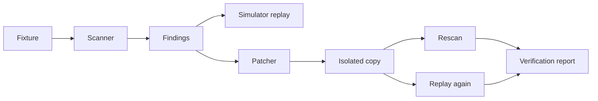

# Architecture

Packages: `scanner`, `simulator`, `patcher`, `reporting`, `fixtures`, and `mcp-dev`. The CLI uses their Node entries, which read fixtures and write work copies on disk. The web workbench uses their `browser` entries, which have no Node built-ins: `apps/web/src/engine.ts` runs the fixed fixture, replay, and patch actions in the visitor's tab, and `pnpm build` bundles it with esbuild into a static site that Cloudflare Workers serves as an assets-only Worker. The dev-only `gravescan-dev` MCP server exposes the same fixed flow over stdio and is disabled by default in `.kiro/settings/mcp.json`.

Full requirements: see the PRD and `.kiro/specs/`.
