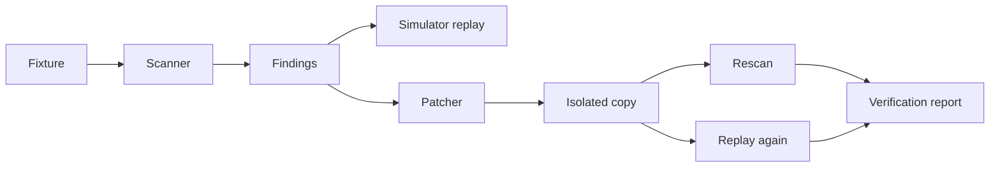

# Architecture

Packages: `scanner`, `simulator`, `patcher`, `reporting`, `fixtures`, and `mcp-dev`; consumed by the CLI and the local web server in `apps/web/src/server.ts`. The server exposes only fixed fixture/replay/patch endpoints and serves the dependency-free workbench. The dev-only `gravescan-dev` MCP server exposes the same fixed flow over stdio and is disabled by default in `.kiro/settings/mcp.json`.

Full requirements: see the PRD and `.kiro/specs/`.
